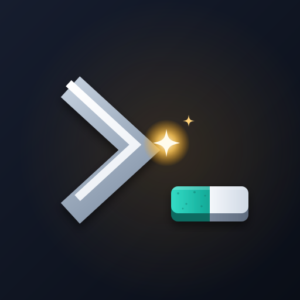

<p align="center"></p>

<h1 align="center">whetstone-dev.github.io</h1>

<p align="center"><b>whetstone-dev</b> is an open-source AI lab from Colombia.<br>
We build skills and guides that turn general-purpose agents into specialists.<br>
<a href="https://whetstone-dev.github.io/">whetstone-dev.github.io</a></p>

---

This repository is the organization's website: who we are, what we do, our projects, the team and how to reach us. Each project keeps its own repository and, when it has one, its own site under the same domain (for example [`/network-engineering/`](https://whetstone-dev.github.io/network-engineering/)).

## Stack

- Next.js 16 (App Router) with `output: 'export'`, deployed to GitHub Pages by [`.github/workflows/pages.yml`](.github/workflows/pages.yml)
- TypeScript, plain CSS ([`src/app/globals.css`](src/app/globals.css)), no runtime dependencies besides React
- English and Spanish: typed dictionaries in [`src/i18n/dictionaries/`](src/i18n/dictionaries/), routes under `/en/` and `/es/`

## Develop

Requires Node.js 22.18 or newer.

```bash
npm install
npm run dev        # http://localhost:4175
npm run typecheck
npm run build      # static site in out/
```

## Content

| What | Where |
| --- | --- |
| Projects (cards and `/projects/<slug>/` pages) | [`src/content/projects.ts`](src/content/projects.ts) + `public/projects/<slug>/preview.png` |
| Team | [`src/content/maintainers.ts`](src/content/maintainers.ts) |
| Every visible text (mission, values, areas, contact) | [`src/i18n/dictionaries/`](src/i18n/dictionaries/) |
| GitHub links (discussions, project proposals) | [`src/lib/site.ts`](src/lib/site.ts) |

When a project ships a new release, update its `version` in `projects.ts`.

To add a language, create `src/i18n/dictionaries/<code>.ts` (TypeScript enforces every key), register it in [`src/i18n/config.ts`](src/i18n/config.ts), and add the localized fields to each project and maintainer.

## License

[MIT](LICENSE)
